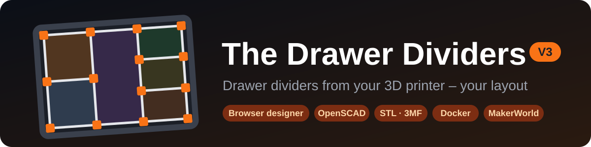
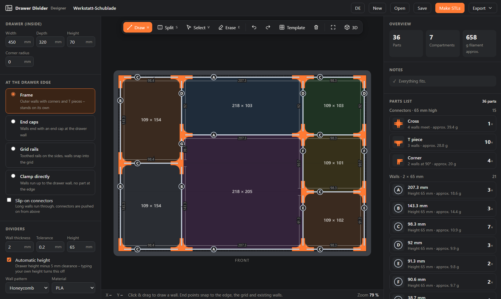

<p align="center">
  
</p>

<p align="center">
  <b>Measure your drawer, draw the compartments, get every part as an STL – right in the browser.</b><br>
  Walls, connectors and rails from your 3D printer, fully parametric in OpenSCAD. Nothing to install.
</p>

<p align="center">
  <a href="https://barry2040.github.io/the-drawer-dividers/"><b>▶ Open the designer: barry2040.github.io/the-drawer-dividers</b></a><br>
  🇩🇪 <a href="README.md">Deutsche Version</a>
</p>

> [!WARNING]
> **Vibe-coded:** This project was made with AI assistance (Claude) by "vibe coding" – in conversation, step by step.
> Automatic checks run on every push (all SCAD files render, the HTML and SCAD designers compute the same parts),
> but it **may still contain bugs**. Print the tolerance test (`scad/tolerance_test.scad`) before you print a whole drawer.
> Please report bugs and ideas as an [issue](https://github.com/Barry2040/the-drawer-dividers/issues).

<p align="center">
  
</p>

---

## ✨ Features

| | |
|---|---|
| ✏️ **Draw compartments** | Drag walls with the mouse, split a compartment into 2–6 with one click, move, erase – snapping to the edge, the grid and other walls |
| 🗂️ **Templates** | Ready-made layouts to start from: grid (N × M), cutlery, workshop, mixed, desk, small parts |
| 🧮 **Parts list** | Every part with size, quantity and filament – connectors by type, walls by length |
| 🔤 **Wall letters** | Every wall length gets a letter (A = longest). Letter and length are engraved into the wall end, which disappears inside the connector |
| 🛡️ **Checks** | Compartments too narrow, overlapping connectors, dividers too tall, parts too long for the bed – all marked red and explained |
| 🧱 **Four edge modes** | Frame, end caps, grid rails or clamp directly – plus optional slip-on connectors |
| ⭕ **Round corners** | If the drawer has round inside corners, the frame corners are rounded to match |
| 🏷️ **Label clips** | One clip per compartment to push onto the wall – write on it or stick a label on |
| 🐝 **Wall patterns** | Honeycomb, circles or solid – saves filament and looks good |
| 🧊 **3D preview** | The whole assembly in 3D, patterns included |
| 🖨️ **STLs in the browser** | OpenSCAD runs right in the page and renders every print plate to fit your bed |
| 📦 **3MF & ZIP** | All plates in one 3MF file (Bambu Studio, OrcaSlicer, PrusaSlicer) or a ZIP with STLs, parts list and project |
| 📋 **Assembly plan** | To print or save as PDF: drawing with wall letters, parts list and assembly steps |
| 🔗 **Share link** | The whole layout is in the link – to send around or for MakerWorld |
| 💾 **Profiles** | Save tolerance, bed size and so on for your printer and load them for the next drawer |
| 🌐 **Languages** | German and English, switch at the top right |
| 🐳 **Docker** | Your own server for the home network (NAS, Raspberry Pi) – works without any internet |
| 🧩 **OpenSCAD library** | Every part also as a single SCAD file and as a library for your own projects |

## 🚀 Getting started

| You want to … | How |
|---|---|
| 🖥️ **plan a drawer** and get all the STLs | [**Open the designer online**](https://barry2040.github.io/the-drawer-dividers/) – Chrome, Edge or Firefox, ideally on a PC |
| 📴 work **offline** | In the designer: *Export → Download offline version* – one single HTML file (about 200 KB), double-click to open |
| 🐳 run it **on your server** | [With Docker](#-docker) – one command |
| 🔢 work **with numbers instead of drawing** (e.g. on MakerWorld) | [SCAD designer](#-scad-designer-no-drawing) in OpenSCAD |
| 🔁 **reprint single parts** | `scad/connector.scad`, `wall.scad`, `rail.scad`, `label_clip.scad` in OpenSCAD |
| 📏 **check first** whether the walls fit | print `scad/tolerance_test.scad` |

> [!TIP]
> Only the offline file in the main folder works on its own ([`Drawer-Divider-Designer.html`](Drawer-Divider-Designer.html)), not the files in `designer/`. With it you only need internet for the 3D preview and *Make STLs*.

## 🧩 The system

<table>
<tr><td width="50%" valign="top">

**🧱 Walls**<br>
Flat plates at the height of your dividers, optionally with a honeycomb or circle pattern. Each wall sits 14 mm deep in its connector.

**🔶 Connectors**<br>
Hold the walls together:
*cross* (4 walls) · *T piece* (3) · *corner* (2 at a right angle) · *straight* (joins a wall that is too long) · *end cap* (wall end at the drawer wall)

**📌 Slip-on connectors** *(optional)*<br>
Long walls run through the crossings and the connectors are pushed on from above. Fewer, longer walls – the walls are 2 mm lower so the cap sits flush.

</td><td width="50%" valign="top">

**At the drawer edge – four options:**

| | |
|---|---|
| **Frame** | Outer walls with corners and T pieces – stands on its own and can be lifted out |
| **End caps** | No outer wall, the walls end with an end cap at the drawer wall |
| **Grid rails** | Toothed rails on the sides, the walls snap in between the teeth |
| **Clamp directly** | The walls run up to the drawer wall, no part at the edge |

</td></tr>
</table>

V3 follows the MakerWorld projects [V1 – The Drawer Dividers](https://makerworld.com/en/models/496828-the-drawer-dividers) and [V2 – Parametric System](https://makerworld.com/en/models/3106623-the-drawer-dividers-v2-parametric-system). The defaults are those of V2: 2 mm walls, 0.2 mm tolerance, open connectors.

## 🛠️ Step by step

1. **📐 Measure the drawer** – enter the inside width, depth and height (and the *corner radius* for round corners). The divider height follows automatically: drawer height minus 5 mm clearance.
2. **🧱 Choose the edge** – frame, end caps, grid rails or clamp directly; tick *Slip-on connectors* if you like.
3. **✏️ Lay out the compartments** – with the tools above the drawing:

   | Tool | Key | How |
   |---|---|---|
   | 🗂️ Template | – | a ready-made layout to start from |
   | ➗ Split | `S` | pick a number (`2`–`6` or *free*) and a direction (`Shift` toggles), click into a compartment |
   | ✏️ Draw | `W` | drag a wall with the mouse |
   | 👆 Select | `V` | click a wall and move it, `Del` deletes it |
   | 🧽 Erase | `E` | removes the wall piece between two connectors |
   | ↩️ Undo | `Ctrl+Z` / `Ctrl+Y` | |
   | 🧊 3D | – | preview of the assembly |

   The mouse wheel zooms, the right or middle button pans, `F` fits the view.
4. **🧮 Check the parts list** – every part is listed on the right. *Notes* tell you when something doesn't fit.
5. **🖨️ Make STLs** – the orange button at the top right. OpenSCAD renders plate by plate in the browser. Then download each STL on its own, everything as **3MF** or as a **ZIP**.
6. **📋 Print the assembly plan** – *Export → Print assembly plan / PDF*. The letters in the plan show which wall goes where.

> [!NOTE]
> The first time you *Make STLs*, OpenSCAD is loaded (about 11 MB from jsDelivr). If the browser doesn't allow a background process for a local file, it renders inside the page instead – it works the same, the page is just slower to respond meanwhile. The tolerance test is rendered from the print job `.scad` in OpenSCAD, because it needs fonts.

### 🛡️ What the designer checks for you

| | |
|---|---|
| **Real sizes** | The numbers on the walls are the printed length into the slots. The tick marks of the dimension line show where the wall ends |
| **No overlaps** | Every connector arm is 20 mm long, so two connectors on one wall need at least **41 mm** between them. The designer doesn't allow closer splits in the first place |
| **Walls almost in line** | Walls just a few millimetres next to another one snap onto its line – a cross sits there then |
| **Walls too long** | Longer than *Max. wall length* → split, with a straight joiner or at a crossing with slip-on connectors |
| **Changing the edge mode** | The compartments keep their size, the inner walls move along. With grid rails they snap into the 4.2 mm pitch |

### ⚙️ Settings

- **Dividers** – wall thickness, tolerance, height, wall pattern and material. Usually that's all you need.
- **Advanced** – print bed, max. wall length, printing standing or lying flat, finger notch, snap grid, label clips, wall labels, all connector dimensions and the grid rail. *Reset everything to default* brings back the V2 values.
- **My profile** – saves everything except drawer, edge and compartments under a name, e.g. for your printer.

The designer saves your project automatically in the browser. *Save* / *Open* keep it as a `.json` file.

## 🖨️ Printing tips

> [!TIP]
> **Print the tolerance test first** (`scad/tolerance_test.scad` or the last plate of the print job). It has five labelled slots and a test wall. Enter the tolerance at which the wall goes in snugly but without force, and save it in your profile.

| Part | Tip |
|---|---|
| 🧱 **Walls** | Standing is faster, lying flat is stronger (*Advanced → Orientation*). *Wall thickness* is the thickness actually printed – if your printer prints 2 mm as 2.1 mm, enter 2.1 |
| 🔶 **Connectors** | Print open side up, no supports |
| 📌 **Slip-on connectors** | Print cap down, then flip them over and push them on |

## 🐳 Docker

For your own server in the home network (NAS, Raspberry Pi …). The image contains the designer **plus three.js and OpenSCAD**, so the 3D preview and *Make STLs* work without any internet. It is built for x86 and ARM.

```bash
docker run -d --name drawer-divider -p 8080:8080 --restart unless-stopped ghcr.io/barry2040/the-drawer-dividers:latest
```

Then open `http://<server>:8080` in your browser.

| | |
|---|---|
| **Docker Compose** | take [`docker-compose.yml`](docker-compose.yml) and run `docker compose up -d` |
| **Updating** | `docker compose pull && docker compose up -d` – a new image is published automatically on every change to the designer |
| **Build it yourself** | `docker build -t drawer-divider .` – the [`Dockerfile`](Dockerfile) downloads three.js and OpenSCAD once |

> [!NOTE]
> Projects and profiles are kept in the browser, just like online, not on the server. Shared links point to your server.

## 🔢 SCAD designer (no drawing)

Open `scad/drawer_designer.scad` in OpenSCAD and fill in the Customizer on the right:

| Section | What |
|---|---|
| **Drawer** | inside width, depth, height, corner radius |
| **Compartments** | `Strips = "1,1,2"` splits into strips (the third twice as wide). `Splits = "2,3,1:2"` sets the compartments per strip: a number = equal compartments, `1:2` = relative sizes. `Direction` sets which way the strips run |
| **Drawer edge** | frame, end caps, grid rails or clamp directly, optionally slip-on connectors |
| **Output** | *assembly with parts list* → *all printed parts* → or one line of the parts list (`Part_Number`) per print plate, then F6 and F7 |
| **System** | wall thickness, tolerance, height, wall labels, label clips, connector dimensions |

It applies the same rules as the HTML designer. Compartments that are too narrow are marked red and reported in the console.

> [!TIP]
> **Nothing to install:** the single file `dist/makerworld/en/drawer_designer.scad` (German: `de/schubladen_designer.scad`) can be uploaded to **MakerWorld** as a parametric model or opened in the **OpenSCAD Playground** (`ochafik.com/openscad2`).

## 📚 Library for your own projects

<details>
<summary>All parts use the same <b>profile</b> – so wall, connector and rail always fit together. <i>(click to expand)</i></summary>

```openscad
use <lib/drawer_divider.scad>

P = dd_profile(wall_t = 2, tol = 0.2, height = 40);   // everything else has defaults

dd_connector("tee", P);
translate([60, 0, 0]) dd_wall(118, P, pattern = "hex", label = "A", label2 = "118");
translate([0, 60, 0]) dd_rail(200, 40, P);
translate([0, -40, 0]) dd_label_clip(40, P);
```

| Module / function | What |
|---|---|
| `dd_connector(type, P, slip = false, corner_r = 0)` | `cross`, `tee`, `corner`, `corner_round` (rounded outside, `corner_r`), `straight`, `end`, `slip_cross`, `slip_tee`, `slip_corner_r`, `slip_corner_l` |
| `dd_connector_custom(arms, slots, through_y, cap, P)` | any combination of arms |
| `dd_wall(length, P, …, label, label2)` | wall with honeycomb/circle pattern, finger notch, end chamfers, engraving in the wall ends |
| `dd_rail(length, width, P, …)` | grid rail with tongue/socket, screw holes, `teeth_offset` |
| `dd_label_clip(width, P, …)` | label clip to push onto a wall |
| `dd_tolerance_test(P, tols)` | test block with several slot widths plus a test wall |
| `dd_layout(P, opts)` / `dd_layout_bom(L)` | compartment layout → walls, connectors, rails, parts list |
| `dd_layout_clashes(L, P)` | connectors that would overlap |

</details>

## 🆚 Improvements over V2

<details>
<summary>Fixes and new things in detail <i>(click to expand)</i></summary>

- **One shared profile** for all parts instead of a wall thickness/tolerance in every file
- **Designer** in the browser and as a SCAD file, checking for overlapping connectors
- **Rail tooth chamfer fixed** – the old chamfer had no effect (hull over two bodies of the same width)
- **Fillet at the tooth root fixed** – now a real fillet across the full tooth width instead of small bumps
- **Rail joints** – `teeth_offset` keeps the tooth pitch continuous across several rails
- **Screw holes** sit in the middle of a slot so fewer teeth are damaged
- **Connector outline** via offset rounding – every combination of arms gets clean inner radii
- **Magnet pocket** in every connector with a solid centre
- **Wall pattern** – the border follows the insert depth, the honeycomb height is computed correctly
- **New**: end cap, slip-on connectors, finger notch, printing lying flat, optional cap, tolerance test with 5 labelled slots, rounded frame corners, engraved wall letters, label clips, templates, share links, assembly plan, 3MF export, English interface, Docker

</details>

## 🔒 Privacy

The designer keeps projects, profiles and settings **only in the browser** of your device – no account, no server. A shared link contains the layout itself; it isn't uploaded anywhere.

For the 3D preview the page loads **three.js**, and for *Make STLs* **OpenSCAD**, from **jsDelivr** – like any website, jsDelivr sees your IP address. Your drawer is not sent anywhere. The [Docker version](#-docker) loads nothing from outside at all.

## 👩‍💻 For developers

<details>
<summary>Files, build and checks <i>(click to expand)</i></summary>

```
Drawer-Divider-Designer.html  the designer as one single file (generated)
designer/                     HTML designer, source
  dev.html                    user interface (only works with the .js files next to it)
  i18n.js                     language: English texts, DE/EN switch
  app.js                      planning, parts list, checks, 3D preview, assembly plan, print job
  stl.js                      STL rendering with OpenSCAD in the browser, ZIP and 3MF download
  scad_lib.js                 embedded SCAD library (generated)
scad/
  drawer_designer.scad        SCAD designer
  connector.scad              single parts: connectors
  wall.scad                   single parts: walls
  rail.scad                   single parts: grid rail
  label_clip.scad             single parts: label clip
  tolerance_test.scad         tolerance test
  lib/drawer_divider.scad     library – all geometry and the layout logic
dist/makerworld/en/ de/       single files for MakerWorld (library inlined, generated)
legacy/v2-original/           original V2 SCADs
docs/                         banners and screenshots for the README
tools/
  build.py                    makes all generated files
  i18n_de.py                  German Customizer names for MakerWorld
  check.py                    checks (run by GitHub Actions)
  i18n_keys.py                finds designer texts without an English translation
Dockerfile, docker-compose.yml  Docker version
.github/workflows/            pages.yml (GitHub Pages), check.yml (checks), docker.yml (image on ghcr.io)
```

After changes in `scad/` or `designer/`, rebuild the generated files:

```bash
python tools/build.py
```

- `python tools/check.py` renders every SCAD file, compares the parts of the HTML and SCAD designers for several layouts and checks that every designer text is translated. It runs on every push in GitHub Actions (*Prüfung*), together with a check that the generated files are up to date. Needs OpenSCAD and Playwright (`pip install playwright && playwright install chromium`).
- The designer is written in German. Write new texts as `T('…')` or ``T`… ${x} …` `` and add the English translation to `designer/i18n.js`.
- The formulas for wall lengths and gaps exist twice: in `scad/lib/drawer_divider.scad` and in `designer/app.js` (`geom()`, `analyze()`). If you change one, change the other too.
- Tested with OpenSCAD 2021.01. Newer versions (Manifold) render much faster.

</details>

## 🙏 Credits

| Project | Used for | License |
|---|---|---|
| [OpenSCAD](https://openscad.org) | all the geometry | GPL-2.0 |
| [openscad-wasm-prebuilt](https://www.npmjs.com/package/openscad-wasm-prebuilt) | OpenSCAD in the browser for *Make STLs* | GPL-2.0 |
| [three.js](https://threejs.org) | 3D preview | MIT |
| [nginx](https://nginx.org) ([nginx-unprivileged](https://github.com/nginxinc/docker-nginx-unprivileged)) | web server in the Docker image | BSD-2-Clause |

Ideas and dimensions come from the predecessors on MakerWorld: [V1](https://makerworld.com/en/models/496828-the-drawer-dividers) and [V2](https://makerworld.com/en/models/3106623-the-drawer-dividers-v2-parametric-system).
