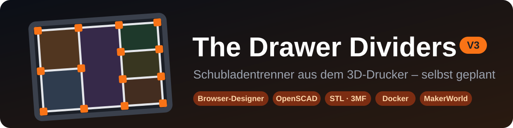
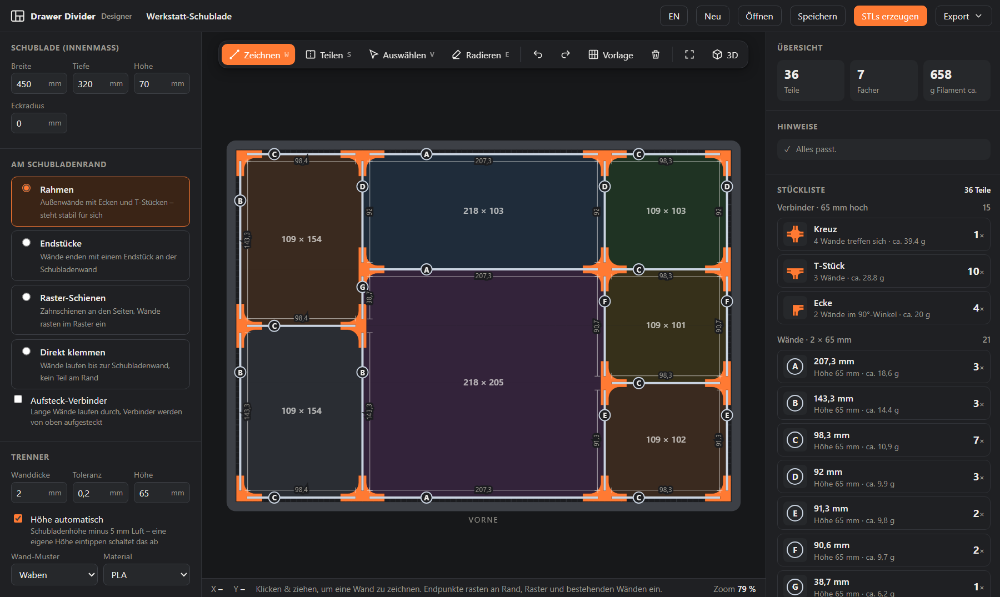

<p align="center">
  
</p>

<p align="center">
  <b>Schublade ausmessen, Fächer zeichnen, alle Teile als STL bekommen – direkt im Browser.</b><br>
  Wände, Verbinder und Schienen aus dem 3D-Drucker, komplett parametrisch in OpenSCAD. Keine Installation nötig.
</p>

<p align="center">
  <a href="https://barry2040.github.io/the-drawer-dividers/"><b>▶ Designer öffnen: barry2040.github.io/the-drawer-dividers</b></a><br>
  🇬🇧 <a href="README.en.md">English version</a>
</p>

> [!WARNING]
> **Vibe-coded:** Dieses Projekt ist mit KI-Unterstützung (Claude) im „Vibe Coding“ entstanden – im Gespräch, Schritt für Schritt.
> Bei jedem Push laufen automatische Prüfungen (alle SCAD-Dateien rendern, HTML- und SCAD-Designer rechnen dieselben Teile),
> trotzdem **kann es Fehler enthalten**. Druck zuerst den Toleranztest (`scad/tolerance_test.scad`), bevor du eine ganze Schublade druckst.
> Fehler und Ideen gerne als [Issue](https://github.com/Barry2040/the-drawer-dividers/issues) melden.

<p align="center">
  
</p>

---

## ✨ Funktionen

| | |
|---|---|
| ✏️ **Fächer zeichnen** | Wände mit der Maus ziehen, Fächer per Klick in 2–6 Teile teilen, verschieben, radieren – mit Einrasten an Rand, Raster und anderen Wänden |
| 🗂️ **Vorlagen** | Fertige Aufteilungen als Start: Raster (N × M), Besteck, Werkstatt, Gemischt, Schreibtisch, Kleinteile, Werkzeug, Bits & Schrauben, Küche |
| 🧮 **Stückliste** | Alle Teile mit Maß, Anzahl und Filament – Verbinder nach Typ, Wände nach Länge |
| 💶 **Kosten & Druckzeit** | Filament in Gramm und Metern, Materialkosten und eine grobe Druckzeit – Preis und Druckleistung stellst du unter *Erweitert* ein |
| 🔤 **Wandbuchstaben** | Jede Wandlänge bekommt einen Buchstaben (A = längste). Buchstabe und Länge werden ins Wandende graviert, das im Verbinder verschwindet |
| 🛡️ **Prüfungen** | Zu enge Fächer, sich überschneidende Verbinder, zu hohe Trenner, zu lange Teile fürs Druckbett – alles wird rot markiert und erklärt |
| 🧱 **Vier Randarten** | Rahmen, Endstücke, Raster-Schienen oder direkt klemmen – plus optional Aufsteck-Verbinder |
| ⭕ **Runde Ecken** | Hat die Schublade innen runde Ecken, werden die Rahmenecken passend abgerundet |
| 🏷️ **Fachnamen & Clips** | Fächer benennen (anklicken oder doppelklicken). Der Name steht im Plan und wird in den Beschriftungsclip graviert – oder als Etiketten-Liste für [Open Label Studio](https://github.com/Barry2040/open-label-studio) exportiert |
| 📏 **Messen** | Abstände in der Zeichnung messen, rastet an Wänden und Raster ein |
| 🔢 **Maße eintippen** | Wandposition oder Breite/Tiefe eines Fachs direkt eingeben – die Nachbarwand rückt nach. Mehrere Wände mit `Shift`+Klick wählen und **gleich verteilen** |
| 🪜 **Wandhöhen** | Einzelne Wände niedriger machen, z. B. vorne zum besseren Hineingreifen |
| ✂️ **Gegenstände einplanen** | Schere, Zollstock, Besteck … als Umriss in die Schublade legen und die Fächer drumherum zeichnen |
| 📷 **Foto als Vorlage** | Foto der Schublade laden, vier Ecken anklicken – es wird gerade gerückt und zum Nachzeichnen hinterlegt |
| 🔄 **Spiegeln & Drehen** | Für die Schublade auf der anderen Seite oder quer eingebaute Schubladen |
| 🐝 **Wandmuster** | Waben, Kreise oder geschlossen – spart Filament und sieht gut aus |
| 🧊 **3D-Vorschau** | Der ganze Zusammenbau in 3D, inklusive Muster |
| 🖨️ **STLs im Browser** | OpenSCAD läuft direkt in der Seite und rechnet jede Druckplatte passend zu deinem Druckbett. Die Teile werden gemischt dicht gepackt (weniger Platten) – oder sortenrein |
| 📦 **3MF & ZIP** | Alle Platten in einer 3MF-Datei (Bambu Studio, OrcaSlicer, PrusaSlicer) oder als ZIP mit STLs, Stückliste und Projekt |
| 📋 **Aufbauplan** | Zum Ausdrucken oder als PDF: Zeichnung mit Wandbuchstaben, Teileliste und Aufbauschritte |
| 🔗 **Link teilen** | Das ganze Layout steckt im Link – zum Verschicken oder für MakerWorld |
| ✅ **Druck-Checkliste** | Die Druckplatten zum Abhaken – praktisch, wenn der Druck über mehrere Tage geht |
| 📱 **Handy & App** | Zwei Finger zoomen und verschieben. Online lässt sich der Designer als App installieren und startet dann auch ohne Internet |
| 🗄️ **Mehrere Schubladen** | Beliebig viele Schubladen im Browser, umschalten oben neben dem Namen – mit Gesamt-Stückliste über alle |
| 💾 **Profile** | Toleranz, Druckbett und Co. für deinen Drucker speichern und bei der nächsten Schublade wieder laden |
| 🌐 **Sprachen** | Deutsch und Englisch, umschaltbar oben rechts |
| 🐳 **Docker** | Eigener Server fürs Heimnetz (NAS, Raspberry Pi) – läuft komplett ohne Internet |
| 🧩 **OpenSCAD-Bibliothek** | Alle Teile auch einzeln als SCAD-Dateien und als Bibliothek für eigene Projekte |

## 🚀 Loslegen

| Du willst … | So geht's |
|---|---|
| 🖥️ **eine Schublade planen** und alle STLs bekommen | [**Designer online öffnen**](https://barry2040.github.io/the-drawer-dividers/) – Chrome, Edge oder Firefox, am besten am PC |
| 📴 **offline** arbeiten | Im Designer *Export → Offline-Version herunterladen* – eine einzige HTML-Datei (ca. 200 KB), per Doppelklick öffnen |
| 🐳 **auf deinem Server** laufen lassen | [Mit Docker](#-docker) – ein Befehl |
| 🔢 **mit Zahlen statt Zeichnen** arbeiten (z. B. auf MakerWorld) | [SCAD-Designer](#-scad-designer-ohne-zeichnen) in OpenSCAD |
| 🔁 **einzelne Teile nachdrucken** | `scad/connector.scad`, `wall.scad`, `rail.scad`, `label_clip.scad` in OpenSCAD |
| 📏 **erst prüfen**, ob die Wände passen | `scad/tolerance_test.scad` drucken |

> [!TIP]
> Von der Offline-Datei läuft nur die aus dem Hauptordner allein ([`Drawer-Divider-Designer.html`](Drawer-Divider-Designer.html)), nicht die Dateien aus `designer/`. Internet brauchst du damit nur für die 3D-Vorschau und *STLs erzeugen*.

## 🧩 Das System

| Teil | Was es macht |
|---|---|
| 🧱 **Wände** | Flache Platten in der Höhe deiner Trenner, optional mit Waben- oder Kreismuster. Jede Wand steckt 14 mm tief im Verbinder |
| 🔶 **Verbinder** | Halten die Wände zusammen: *Kreuz* (4 Wände) · *T-Stück* (3) · *Ecke* (2 im Winkel) · *Gerade* (verlängert eine zu lange Wand) · *Endstück* (Wandende an der Schubladenwand) |
| 📌 **Aufsteck-Verbinder** | *Optional.* Lange Wände laufen über die Kreuzungen durch, die Verbinder werden von oben aufgesteckt. Weniger, längere Wände – dafür sind die Wände 2 mm niedriger, damit der Deckel bündig sitzt |
| 🏷️ **Beschriftungsclips** | *Optional.* Werden oben auf eine Wand gesteckt |

**Am Schubladenrand – vier Varianten:**

| Randart | So geht's |
|---|---|
| **Rahmen** | Außenwände mit Ecken und T-Stücken – steht für sich und lässt sich herausnehmen |
| **Endstücke** | Keine Außenwand, die Wände enden mit einem Endstück an der Schubladenwand |
| **Raster-Schienen** | Zahnschienen an den Seiten, die Wände rasten zwischen den Zähnen ein |
| **Direkt klemmen** | Die Wände laufen bis zur Schubladenwand, kein Teil am Rand |

V3 ist der Nachfolger der MakerWorld-Projekte [V1 – The Drawer Dividers](https://makerworld.com/de/models/496828-the-drawer-dividers) und [V2 – Parametric System](https://makerworld.com/de/models/3106623-the-drawer-dividers-v2-parametric-system). Die Standardwerte sind die von V2: 2 mm Wände, 0,2 mm Toleranz, offene Verbinder.

## 🛠️ Schritt für Schritt

1. **📐 Schublade ausmessen** – Innenbreite, -tiefe und -höhe eintragen (bei runden Ecken auch den *Eckradius*). Die Höhe der Trenner stellt sich automatisch ein: Schubladenhöhe minus 5 mm Luft.
2. **🧱 Rand wählen** – Rahmen, Endstücke, Raster-Schienen oder direkt klemmen; bei Bedarf *Aufsteck-Verbinder* anhaken.
3. **✏️ Fächer anlegen** – mit den Werkzeugen über der Zeichnung:

   | Werkzeug | Taste | So geht's |
   |---|---|---|
   | 🗂️ Vorlage | – | fertige Aufteilung als Start |
   | ➗ Teilen | `S` | Anzahl wählen (`2`–`6` oder *frei*), Richtung wählen (`Shift` wechselt), in ein Fach klicken |
   | ✏️ Zeichnen | `W` | Wand mit der Maus ziehen |
   | 👆 Auswählen | `V` | Wand anklicken und verschieben oder Position eintippen, `Entf` löscht sie. `Shift`+Klick wählt weitere Wände. Fach anklicken, um es zu benennen oder sein Maß einzugeben |
   | 🧽 Radieren | `E` | entfernt das Wandstück zwischen zwei Verbindern – so legst du auch zwei Fächer zusammen |
   | 📏 Messen | `M` | Abstand ziehen, `Shift` misst ohne Einrasten |
   | ✂️ Gegenstand | `G` | Umriss einfügen (Vorlagen für Werkstatt, Küche, Büro) |
   | 📷 Foto | – | Foto der Schublade als Vorlage hinterlegen |
   | 🔄 Spiegeln / Drehen | – | ganzes Layout spiegeln oder um 90° drehen |
   | ↩️ Rückgängig | `Strg+Z` / `Strg+Y` | |
   | 🧊 3D | – | Vorschau des Zusammenbaus |

   Mausrad zoomt, rechte oder mittlere Maustaste verschiebt die Ansicht, `F` passt sie ein.
4. **🧮 Stückliste prüfen** – rechts stehen alle Teile. Unter *Hinweise* steht, wenn etwas nicht passt.
5. **🖨️ STLs erzeugen** – der orange Button oben rechts. OpenSCAD rechnet im Browser Platte für Platte. Danach jede STL einzeln, alles als **3MF** oder als **ZIP** herunterladen.
6. **📋 Aufbauplan drucken** – *Export → Aufbauplan drucken / PDF*. Die Buchstaben im Plan zeigen, welche Wand wohin gehört.

> [!NOTE]
> Beim ersten *STLs erzeugen* wird OpenSCAD geladen (ca. 11 MB von jsDelivr). Erlaubt der Browser bei einer lokalen Datei keinen Hintergrund-Prozess, rechnet er direkt in der Seite – das geht genauso, die Seite reagiert dabei nur langsamer. Den Toleranztest rechnest du aus der Druckjob-`.scad` in OpenSCAD, weil er Schrift braucht.

### 🛡️ Was der Designer für dich prüft

| | |
|---|---|
| **Echte Maße** | Die Zahlen an den Wänden sind die Drucklänge bis in den Schlitz. Die Endstriche der Maßlinie zeigen, wo die Wand endet |
| **Kein Überschneiden** | Jeder Verbinder-Arm ist 20 mm lang, zwei Verbinder auf einer Wand brauchen also mindestens **41 mm** Abstand. Engere Teilungen lässt der Designer gar nicht erst zu |
| **Fast fluchtende Wände** | Wände, die nur wenige Millimeter neben einer anderen liegen, rasten auf deren Linie ein – dann sitzt dort ein Kreuz |
| **Zu lange Wände** | Länger als *Max. Wandlänge* → geteilt, mit gerader Verlängerung oder bei Aufsteck-Verbindern an einer Kreuzung |
| **Randart wechseln** | Die Fächer bleiben gleich groß, die Innenwände wandern mit. Bei Raster-Schienen rasten sie ins 4,2-mm-Raster |

### ⚙️ Einstellungen

- **Trenner** – Wanddicke, Toleranz, Höhe, Wand-Muster und Material. Mehr brauchst du meistens nicht.
- **Erweitert** – Druckbett, max. Wandlänge, liegend oder stehend drucken, Griffmulde, Fangraster, Beschriftungsclips, Wände beschriften, alle Verbinder-Maße und die Raster-Schiene. *Alles auf Standard zurücksetzen* holt die V2-Werte zurück.
- **Mein Profil** – speichert alles außer Schublade, Rand und Fächern unter einem Namen, z. B. für deinen Drucker.

Dein Projekt speichert der Designer automatisch im Browser. Mit *Speichern* / *Öffnen* sicherst du es als `.json`-Datei.

## 🖨️ Druck-Tipps

> [!TIP]
> **Zuerst den Toleranztest drucken** (`scad/tolerance_test.scad` oder die letzte Platte im Druckjob). Er hat fünf beschriftete Schlitze und eine Testwand. Die Toleranz, bei der die Wand stramm, aber ohne Gewalt hineingeht, trägst du im Designer ein und speicherst sie im Profil.

| Teil | Tipp |
|---|---|
| 🧱 **Wände** | Stehend geht schneller, liegend ist stabiler (*Erweitert → Ausrichtung*). Die *Wanddicke* ist die tatsächlich gedruckte Dicke – druckt dein Drucker 2 mm als 2,1 mm, trag 2,1 ein |
| 🔶 **Verbinder** | Mit der offenen Seite nach oben drucken, ohne Stützen |
| 📌 **Aufsteck-Verbinder** | Mit dem Deckel nach unten drucken, danach umdrehen und aufstecken |

## 🐳 Docker

Für den eigenen Server im Heimnetz (NAS, Raspberry Pi …). Das Image enthält den Designer **samt three.js und OpenSCAD** – 3D-Vorschau und *STLs erzeugen* laufen also ganz ohne Internet. Es gibt das Image für x86 und ARM.

```bash
docker run -d --name drawer-divider -p 8080:8080 --restart unless-stopped ghcr.io/barry2040/the-drawer-dividers:latest
```

Danach `http://<server>:8080` im Browser öffnen.

| | |
|---|---|
| **Docker Compose** | [`docker-compose.yml`](docker-compose.yml) nehmen und `docker compose up -d` |
| **Aktualisieren** | `docker compose pull && docker compose up -d` – ein neues Image kommt bei jeder Änderung am Designer automatisch |
| **Selbst bauen** | `docker build -t drawer-divider .` – das [`Dockerfile`](Dockerfile) lädt three.js und OpenSCAD dabei einmal herunter |

> [!NOTE]
> Projekte und Profile liegen wie online im Browser, nicht auf dem Server. Geteilte Links zeigen auf deinen Server.

## 🔢 SCAD-Designer (ohne Zeichnen)

`scad/drawer_designer.scad` in OpenSCAD öffnen und rechts im Customizer ausfüllen:

| Abschnitt | Was |
|---|---|
| **Schublade** | Innenbreite, -tiefe, -höhe, Eckradius |
| **Fächer** | `Strips = "1,1,2"` teilt in Streifen (der dritte doppelt so breit). `Splits = "2,3,1:2"` legt die Fächer pro Streifen fest: eine Zahl = gleich große Fächer, `1:2` = relative Größen. `Direction` bestimmt die Richtung der Streifen |
| **Am Schubladenrand** | Rahmen, Endstücke, Raster-Schienen oder direkt klemmen, optional Aufsteck-Verbinder |
| **Ausgabe** | *Zusammenbau mit Stückliste* → *Alle Druckteile* → oder eine Zeile der Stückliste (`Part_Number`) pro Druckplatte, dann F6 und F7 |
| **System** | Wanddicke, Toleranz, Höhe, Wände beschriften, Beschriftungsclips, Verbinder-Maße |

Er wendet dieselben Regeln an wie der HTML-Designer. Zu enge Fächer werden rot markiert und in der Konsole gemeldet.

> [!TIP]
> **Ohne Installation:** Die Einzeldatei `dist/makerworld/de/schubladen_designer.scad` (englisch: `en/drawer_designer.scad`) lässt sich auf **MakerWorld** als parametrisches Modell hochladen oder im **OpenSCAD Playground** (`ochafik.com/openscad2`) öffnen.

## 📚 Bibliothek für eigene Projekte

<details>
<summary>Alle Teile nutzen dasselbe <b>Profil</b> – deshalb passen Wand, Verbinder und Schiene immer zusammen. <i>(aufklappen)</i></summary>

```openscad
use <lib/drawer_divider.scad>

P = dd_profile(wall_t = 2, tol = 0.2, height = 40);   // alles Weitere hat Standardwerte

dd_connector("tee", P);
translate([60, 0, 0]) dd_wall(118, P, pattern = "hex", label = "A", label2 = "118");
translate([0, 60, 0]) dd_rail(200, 40, P);
translate([0, -40, 0]) dd_label_clip(40, P);
```

| Modul / Funktion | Was |
|---|---|
| `dd_connector(type, P, slip = false, corner_r = 0)` | `cross`, `tee`, `corner`, `corner_round` (außen gerundet, `corner_r`), `straight`, `end`, `slip_cross`, `slip_tee`, `slip_corner_r`, `slip_corner_l` |
| `dd_connector_custom(arms, slots, through_y, cap, P)` | beliebige Arm-Kombinationen |
| `dd_wall(length, P, …, label, label2)` | Wand mit Waben-/Kreismuster, Griffmulde, Endfasen, Gravur in den Wandenden |
| `dd_rail(length, width, P, …)` | Raster-Schiene mit Zapfen/Buchse, Schraubenlöchern, `teeth_offset` |
| `dd_label_clip(width, P, …)` | Beschriftungsclip zum Aufstecken auf eine Wand |
| `dd_tolerance_test(P, tols)` | Testblock mit mehreren Schlitzbreiten plus Testwand |
| `dd_layout(P, opts)` / `dd_layout_bom(L)` | Fachaufteilung → Wände, Verbinder, Schienen, Stückliste |
| `dd_layout_clashes(L, P)` | Verbinder, die sich überschneiden würden |

</details>

## 🆚 Was gegenüber V2 besser ist

<details>
<summary>Reparaturen und Neues im Detail <i>(aufklappen)</i></summary>

- **Ein gemeinsames Profil** für alle Teile statt eigener Wanddicke/Toleranz in jeder Datei
- **Designer** im Browser und als SCAD-Datei, mit Prüfung auf Verbinder-Überschneidungen
- **Zahn-Fase der Schiene repariert** – die alte Fase hatte keine Wirkung (hull über zwei gleich breite Körper)
- **Hohlkehle am Zahnfuß repariert** – jetzt eine echte Hohlkehle über die ganze Zahnbreite statt kleiner Noppen
- **Schienen-Stöße** – `teeth_offset` hält das Zahnraster über mehrere Schienen hinweg durchgehend
- **Schraubenlöcher** sitzen mittig in einem Schlitz, damit weniger Zähne beschädigt werden
- **Verbinder-Kontur** über Offset-Rundung – jede Arm-Kombination bekommt saubere Innenradien
- **Magnet-Tasche** bei jedem Verbinder mit massiver Mitte
- **Wandmuster** – der Rand richtet sich nach der Einschubtiefe, die Wabenhöhe wird korrekt berechnet
- **Neu**: Endstück, Aufsteck-Verbinder, Griffmulde, liegender Druck, optionaler Deckel, Toleranztest mit 5 beschrifteten Schlitzen, runde Rahmenecken, gravierte Wandbuchstaben, Beschriftungsclips, Vorlagen, Link teilen, Aufbauplan, 3MF-Export, englische Oberfläche, Docker

</details>

## 🔒 Datenschutz

Projekte, Profile und Einstellungen speichert der Designer **nur im Browser** deines Geräts – kein Konto, kein Server. Ein geteilter Link enthält das Layout selbst, es wird nirgends hochgeladen.

Für die 3D-Vorschau lädt die Seite **three.js** und für *STLs erzeugen* **OpenSCAD** von **jsDelivr** – dabei sieht jsDelivr wie bei jeder Webseite deine IP-Adresse. Deine Schublade wird nicht übertragen. Mit der [Docker-Version](#-docker) wird gar nichts von außen geladen.

## 👩‍💻 Für Entwickler

<details>
<summary>Dateien, Build und Prüfungen <i>(aufklappen)</i></summary>

```
Drawer-Divider-Designer.html  der Designer als eine einzige Datei (wird erzeugt)
designer/                     HTML-Designer, Quelle
  dev.html                    Oberfläche (läuft nur mit den .js-Dateien daneben)
  i18n.js                     Sprache: englische Texte, Umschalter DE/EN
  app.js                      Planung, Stückliste, Prüfungen, 3D-Vorschau, Aufbauplan, Druckjob
  stl.js                      STL-Erzeugung mit OpenSCAD im Browser, ZIP- und 3MF-Download
  scad_lib.js                 eingebettete SCAD-Bibliothek (wird erzeugt)
pwa/                          App-Dateien neben der Online-Seite: Manifest, Offline-Cache (sw.js), Icons
fonts/                        Liberation Sans (SIL OFL) – Schrift für Gravuren beim STL-Erzeugen im Browser
scad/
  drawer_designer.scad        SCAD-Designer
  connector.scad              Einzelteile: Verbinder
  wall.scad                   Einzelteile: Wände
  rail.scad                   Einzelteile: Raster-Schiene
  label_clip.scad             Einzelteile: Beschriftungsclip
  tolerance_test.scad         Toleranztest
  lib/drawer_divider.scad     Bibliothek – alle Geometrie und die Layout-Logik
dist/makerworld/en/ de/       Einzeldateien für MakerWorld (Bibliothek eingebettet, werden erzeugt)
legacy/v2-original/           Original-SCADs von V2
docs/                         Banner und Screenshots für die README
tools/
  build.py                    erzeugt alle generierten Dateien
  i18n_de.py                  deutsche Customizer-Namen für MakerWorld
  check.py                    Prüfungen (laufen in GitHub Actions)
  i18n_keys.py                findet Designer-Texte ohne englische Übersetzung
Dockerfile, docker-compose.yml  Docker-Version
.github/workflows/            pages.yml (GitHub Pages), check.yml (Prüfung), docker.yml (Image auf ghcr.io)
```

Nach Änderungen in `scad/` oder `designer/` die erzeugten Dateien neu bauen:

```bash
python tools/build.py
```

- `python tools/check.py` rendert alle SCAD-Dateien, vergleicht für mehrere Layouts die Teile von HTML- und SCAD-Designer und prüft, dass jeder Designer-Text übersetzt ist. Läuft bei jedem Push in GitHub Actions (*Prüfung*), zusammen mit der Kontrolle, dass die erzeugten Dateien aktuell sind. Braucht OpenSCAD und Playwright (`pip install playwright && playwright install chromium`).
- Neue Texte im Designer schreibst du als `T('…')` bzw. ``T`… ${x} …` `` und trägst die Übersetzung in `designer/i18n.js` ein.
- Die Formeln für Wandlängen und Abstände stehen zweimal: in `scad/lib/drawer_divider.scad` und in `designer/app.js` (`geom()`, `analyze()`). Wer eine ändert, muss die andere mitziehen.
- Getestet mit OpenSCAD 2021.01. Neuere Versionen (Manifold) rendern deutlich schneller.

</details>

## 🙏 Quellen & Danke

| Projekt | Wofür | Lizenz |
|---|---|---|
| [OpenSCAD](https://openscad.org) | die ganze Geometrie | GPL-2.0 |
| [openscad-wasm-prebuilt](https://www.npmjs.com/package/openscad-wasm-prebuilt) | OpenSCAD im Browser für *STLs erzeugen* | GPL-2.0 |
| [three.js](https://threejs.org) | 3D-Vorschau | MIT |
| [nginx](https://nginx.org) ([nginx-unprivileged](https://github.com/nginxinc/docker-nginx-unprivileged)) | Webserver im Docker-Image | BSD-2-Clause |

Die Ideen und Maße stammen aus den Vorgängern auf MakerWorld: [V1](https://makerworld.com/de/models/496828-the-drawer-dividers) und [V2](https://makerworld.com/de/models/3106623-the-drawer-dividers-v2-parametric-system).
